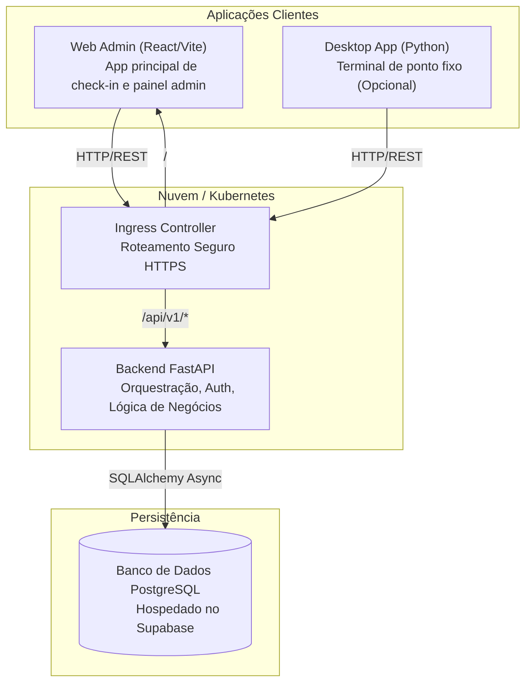

# Arquitetura do Ponto Digital - LabLivre

O Sistema de Ponto Digital do LabLivre foi desenvolvido para ser moderno, multiplataforma, escalável e de fácil manutenção. Ele utiliza uma arquitetura baseada em microsserviços e contêineres.

## Diagrama Geral

## Componentes

### 1. Frontend (`web_admin`)
Responsável pela interface do usuário (UI). Foi construído com foco em leveza e responsividade.
- **Framework:** React com TypeScript, empacotado via Vite.
- **Estilização:** Tailwind CSS v4 (CSS-first `@theme`, sem `tailwind.config.js`) sobre o **Design System Lab Livre** — tema claro único.
- **Ícones:** Lucide React.
- **Roteamento e Funcionalidades:**
  - `/frequencia`: Lançamento de frequência pelo mentor (Presente/Falta por turma/data/turno, com atestado por turno). Substitui a antiga autofrequência do aluno.
  - `/dashboard`, `/pessoas`, `/avaliacoes/*`, `/registrar/*`: Painel do mentor/administrador (navegação roteada). **Somente mentores autenticam** — alunos não têm login.
- **Autenticação:** Baseada em JWT (Bearer Token) armazenado no LocalStorage. Nenhuma sessão de cookies é utilizada (stateless).

#### Design System Lab Livre

Toda a UI do painel é construída sobre um design system único derivado da identidade
oficial do Lab Livre (referência "Design V3"). Especificação: `specs/004-lab-livre-design-system/`.

- **Tokens** (fonte única de verdade) no bloco `@theme` de `web_admin/src/index.css`:
  paleta de marca (roxo `#7023E8`, laranja, navy `#080056`, lavanda, pêssego, semânticos),
  tipografia (**Poppins** títulos + **Inter** corpo, **auto-hospedadas** via `@fontsource`,
  sem CDN externo), raios, elevação e motion. A marcação não contém cores hex fixas.
- **Biblioteca de componentes** em `web_admin/src/components/ui/` (Button, Card, Input,
  Select, Textarea, Badge, Table, Modal, Tabs, Alert/Toast, PageHeader, StatCallout, Blob,
  EmptyState), com estados completos, semântica ARIA e navegação por teclado. Chrome
  compartilhado: `AppHeader`, `AppFooter`, `LabLivreLogo`. Styleguide em `/styleguide`.
- **Boas práticas:** contraste WCAG AA (verificado com axe), responsivo (~375px → desktop),
  `prefers-reduced-motion` honrado, tema claro único (dark mode removido). Nenhuma dependência
  pesada nova (apenas `@fontsource/*` auto-hospedadas e `@axe-core/playwright` nos testes).

#### Avaliação Semanal de Learning Outcomes (LOs)

Funcionalidade aditiva construída na mesma arquitetura hexagonal (domínio → caso de uso →
adaptador de persistência → router `/api/v1/admin/avaliacoes` e `/api/v1/admin/los`).

- **Modelo de dados:** `learning_outcomes` (catálogo), `lo_evaluations` (uma por aluno/semana),
  `lo_evaluation_levels` (nível 1–4 por LO, upsert last-write-wins com atribuição ao mentor) e
  `lo_evaluation_comments` (um por mentor). Migração Alembic dedicada.
- **Semana:** índice inteiro derivado da configuração do programa (`config`: `lo_eval_data_inicio`,
  `lo_eval_num_semanas`), não uma data escolhida por avaliação.
- **Papéis:** mentores = STAFF ou ADMIN/SUPER_ADMIN, restritos à própria turma (`turma_ou_equipe`);
  catálogo de LOs é somente-admin; dados de avaliação são visíveis apenas a mentores/admins.
- **Dashboard e relatório** são computados em tempo de leitura (avaliados/pendentes, por mentor,
  heatmap, regressões); a exportação reutiliza o mecanismo openpyxl/CSV existente. Sem novas
  dependências.

#### Frequência lançada por mentores

Inverte o modelo de presença: a frequência é **lançada pelo mentor**, não auto-registrada
pelo aluno. Segue a arquitetura hexagonal (domínio → caso de uso → adaptador → `/api/v1/frequencia`).

- **Modelo de dados:** `frequencias` (um lançamento por aluno/data/turno — upsert idempotente;
  estado `PRESENTE`/`FALTA`/`JUSTIFICADO`; documento de atestado por turno), `mentor_turmas`
  (vínculo N–N mentor↔turma) e a coluna `users.status` (`ATIVO`/`DESLIGADO`). Migração Alembic
  dedicada (**destrutiva**: descarta os `checkins` do modelo antigo; preserva atestados/avaliações).
- **Atestado no lançamento:** ao marcar Falta, o mentor anexa um atestado àquele turno, que passa a
  Justificado — cobrindo apenas aquele turno. Não há mais tela separada de Atestados; o modelo por
  período (feature 001) permanece como histórico somente-leitura.
- **RBAC por turma:** mentor só acessa/lança as suas turmas (`mentor_turmas`); admin/super-admin
  veem todas. Aplicado no servidor em frequência e avaliações.
- **Status do aluno:** Desligados saem das listas ativas (frequência, avaliação, dashboards) e
  permanecem no histórico e nas exportações (marcados). Reversível.
- **Autenticação:** somente mentores (STAFF/ADMIN) autenticam; removidos o auto-check-in
  (`router_checkin`), o registro/onboarding de aluno e o cliente desktop de autofrequência.

#### Atestados Médicos (justificativa de faltas)

Construído sobre a frequência existente, seguindo a arquitetura hexagonal (domínio →
caso de uso → adaptador de persistência → router `/api/v1/admin/certificados`).

- **Modelo de dados:** `medical_certificates` (documento em BYTEA, período, status
  `ACTIVE`/`REVOKED`, auditoria) e `certificate_days` (vínculo por turno —
  `turno_referencia` — com flag `ativo`). Migração Alembic dedicada.
- **Regra de vínculo:** ao registrar, cada turno esperado do período sem check-in
  presente/atrasado real (FALTA ou já JUSTIFICADO) recebe um `certificate_day`. Faltas
  não são armazenadas; são derivadas da ausência de check-in, então o vínculo é a fonte
  de verdade da justificativa — inclusive para dias futuros do período.
- **Exportação:** ambas as saídas (CSV e Excel) consultam os `certificate_days` ativos e
  exibem os turnos cobertos como `JUSTIFICADO` (atribuído ao atestado) em vez de `FALTA`.
- **Segurança:** registro, consulta, download do documento e revogação são restritos a
  administradores; o documento contém dado sensível de saúde.

### 2. Backend (`backend`)
O coração do sistema, lida com toda a validação de regras, processamento de horas e exportação de dados.
- **Framework:** Python com FastAPI.
- **ORM:** SQLAlchemy (Operações 100% assíncronas com banco de dados para evitar bloqueios).
- **Banco de Dados:** PostgreSQL hospedado remotamente (Supabase/Neon/RDS), utilizando asyncpg.
- **Segurança:** Senhas com hash Bcrypt e rotas estritamente tipadas com validação pelo Pydantic.
- **Desempenho (Produção):** Executado através do Gunicorn com Uvicorn Workers (`uvicorn.workers.UvicornWorker`), garantindo o tratamento seguro de centenas de conexões simultâneas sem perdas.

### 3. Desktop App (`desktop_app`)
- Um cliente desktop legado ou complementar construído em Python, usado para pontos fixos no laboratório físico onde não há a necessidade de abrir navegadores. Possui mecanismo de auto-atualização e operação standalone.

### 4. Orquestração e Deploy (`k8s` e `docker-compose.yml`)
- O projeto foi otimizado para rodar de forma Cloud Native. 
- **Local/Desenvolvimento:** `docker-compose.yml` providencia um ambiente perfeitamente equalizado ao de produção com apenas 1 comando.
- **Produção (Kubernetes):** A pasta `k8s/` provê os manifestos para Deployments isolados, Services, ConfigMaps e rotas Ingress, configurando o ecossistema com usuários "não-root" visando a adequação às normativas de cibersegurança universitárias e corporativas.

## Decisões Arquiteturais

* **Stateful vs Stateless:** O K8s hospeda apenas a camada de computação (Stateless - FastAPI e React). A camada de estado (Stateful - Banco de Dados) está terceirizada em serviço gerenciado na nuvem (Supabase). Isso garante que os pods do Kubernetes possam ser destruídos, escalados e recriados instantaneamente sem nenhuma dor de cabeça com discos corrompidos ou perda de registros de horas dos alunos.
* **APIs Desacopladas:** O Frontend e o Backend são aplicações diferentes, subidas em contêineres isolados, unidos apenas pelo Ingress. Isso permite que a Vercel e o Render possam ser usados para hospedagem se o Laboratório não desejar manter seu próprio cluster Kubernetes.
