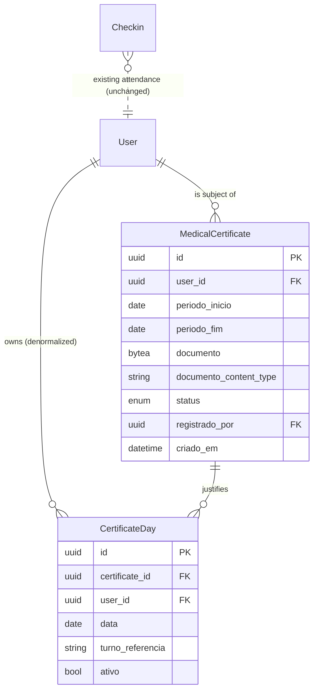

# Phase 1 Data Model: Medical Certificates & Absence Justification

Two new tables are added to the existing PostgreSQL schema. They follow the conventions in
`backend/app/adapters/persistence/orm_models.py` (UUID PKs via `Uuid`, timezone-aware
timestamps with `server_default=func.now()`, `SAEnum` for enums, FKs with explicit
`ondelete`). Domain dataclasses mirror these in `app/domain/models.py`; a new enum lives in
`app/domain/enums.py`.

## New Enum

### `CertificateStatus` (`app/domain/enums.py`)

| Value | Meaning |
|-------|---------|
| `ACTIVE` | Certificate is in force; its covered absent shifts are justified. |
| `REVOKED` | Certificate was revoked by an admin; it no longer justifies any shift, but the record is retained for audit. |

## Entity: Medical Certificate

Table `medical_certificates` — a document-backed justification recorded by an admin for a
student.

| Field | Type | Constraints / Notes |
|-------|------|---------------------|
| `id` | UUID | PK, default `uuid4` |
| `user_id` | UUID | FK → `users.id` `ON DELETE CASCADE`, NOT NULL. The student the certificate applies to; MUST be a user of type `ALUNO` (STAFF out of scope). |
| `periodo_inicio` | Date | NOT NULL. First covered day (inclusive). |
| `periodo_fim` | Date | NOT NULL. Last covered day (inclusive). |
| `documento` | LargeBinary (BYTEA) | NOT NULL. The certificate file bytes. |
| `documento_filename` | String(255) | NOT NULL. Original filename for download. |
| `documento_content_type` | String(100) | NOT NULL. One of `application/pdf`, `image/jpeg`, `image/png`. |
| `documento_tamanho` | Integer | NOT NULL. Size in bytes (for display/validation audit). |
| `observacao` | Text | Nullable. Optional admin note/reason. |
| `status` | `SAEnum(CertificateStatus)` | NOT NULL, default `ACTIVE`, `server_default='ACTIVE'`. |
| `registrado_por` | UUID | FK → `users.id` `ON DELETE SET NULL`, nullable. Admin who recorded it. |
| `revogado_por` | UUID | FK → `users.id` `ON DELETE SET NULL`, nullable. Admin who revoked it. |
| `motivo_revogacao` | Text | Nullable. Reason given at revocation. |
| `criado_em` | DateTime(tz) | `server_default=func.now()`. Recording timestamp. |
| `revogado_em` | DateTime(tz) | Nullable. Revocation timestamp. |

**Relationships**: one certificate → many `certificate_days` (`cascade="all, delete-orphan"`).

**Indexes**:
- `ix_medical_certificates_user` on (`user_id`)
- `ix_medical_certificates_user_periodo` on (`user_id`, `periodo_inicio`, `periodo_fim`)
- `ix_medical_certificates_status` on (`status`)

**Validation rules** (enforced in domain + Pydantic, not only DB):
- `periodo_fim >= periodo_inicio` (FR-003).
- `documento` present and non-empty; `documento_content_type` in the allowed set;
  `documento_tamanho` ≤ 10 MB (FR-003, FR-017).
- `user_id` must reference an existing student of `tipo = ALUNO` (FR-005a).

**State transitions**:
```
(record) → ACTIVE  ──(revoke)──→ REVOKED        [terminal]
```
No transition out of `REVOKED` (a correction is a new certificate record).

## Entity: Certificate Day (link)

Table `certificate_days` — the explicit link between a certificate and one justified shift of
the student. This is the persistent "certificate stays linked to the absent day" record.

| Field | Type | Constraints / Notes |
|-------|------|---------------------|
| `id` | UUID | PK, default `uuid4` |
| `certificate_id` | UUID | FK → `medical_certificates.id` `ON DELETE CASCADE`, NOT NULL. |
| `user_id` | UUID | FK → `users.id` `ON DELETE CASCADE`, NOT NULL. Denormalized for fast export joins. |
| `data` | Date | NOT NULL. The covered day. |
| `turno` | String(50) | NOT NULL. `MANHA` or `TARDE` (matches `Turno`). |
| `turno_referencia` | String(50) | NOT NULL. `"{YYYY-MM-DD}_{MANHA|TARDE}"` — the exact key the attendance export uses, so coverage is a direct lookup. |
| `ativo` | Boolean | NOT NULL, default `True`. Set `False` when the parent certificate is revoked. |
| `criado_em` | DateTime(tz) | `server_default=func.now()`. |

**Relationships**: many `certificate_days` → one `medical_certificate` (`back_populates`).

**Indexes / constraints**:
- `ix_certificate_days_lookup` on (`user_id`, `turno_referencia`, `ativo`) — the export's
  batch coverage lookup.
- `ix_certificate_days_certificate` on (`certificate_id`).
- `UniqueConstraint(certificate_id, turno_referencia)` — a certificate links each shift once;
  overlap across *different* certificates is allowed (two rows, different `certificate_id`).

**Derivation**: `certificate_days` rows are generated from the certificate's `[periodo_inicio,
periodo_fim]` by intersecting with the student's expected shift grid (`TURNOS_ALUNOS` +
`_DIA_SEMANA_MAP`), per research R4, and keeping only shifts that **lack a real present/late
check-in** (currently FALTA, or already JUSTIFICADO) per research R1. A day in range with no
expected shift, or a shift with a real present/late check-in, produces no row.

## Relationship diagram



## Interaction with existing attendance (no schema change to `checkins`)

- A shift `(user, turno_referencia)` is classified `JUSTIFICADO` by this feature when there is
  **no** present/late `Checkin` for it **and** ≥1 `certificate_days` row with `ativo = True`
  exists for that `turno_referencia`. This classification is applied in **both** export
  branches (CSV and Excel); the CSV branch is reworked to enumerate expected `ALUNO` shifts so
  it reports `FALTA`/`JUSTIFICADO` consistently with Excel (research R5).
- Revoking a certificate flips its `certificate_days.ativo` to `False`; the shift reverts to
  `FALTA` unless another active certificate-day still covers it (FR-016, R7).
- The legacy manual `justificar` endpoint (dummy `JUSTIFICADO` check-in) is left untouched for
  now; the two mechanisms coexist. A shift already JUSTIFICADO by that flow is still link-
  eligible (a `certificate_days` row is added), so the document-backed origin is recorded.
  Fully reconciling the two mechanisms is follow-up tech debt, out of scope for this feature.
