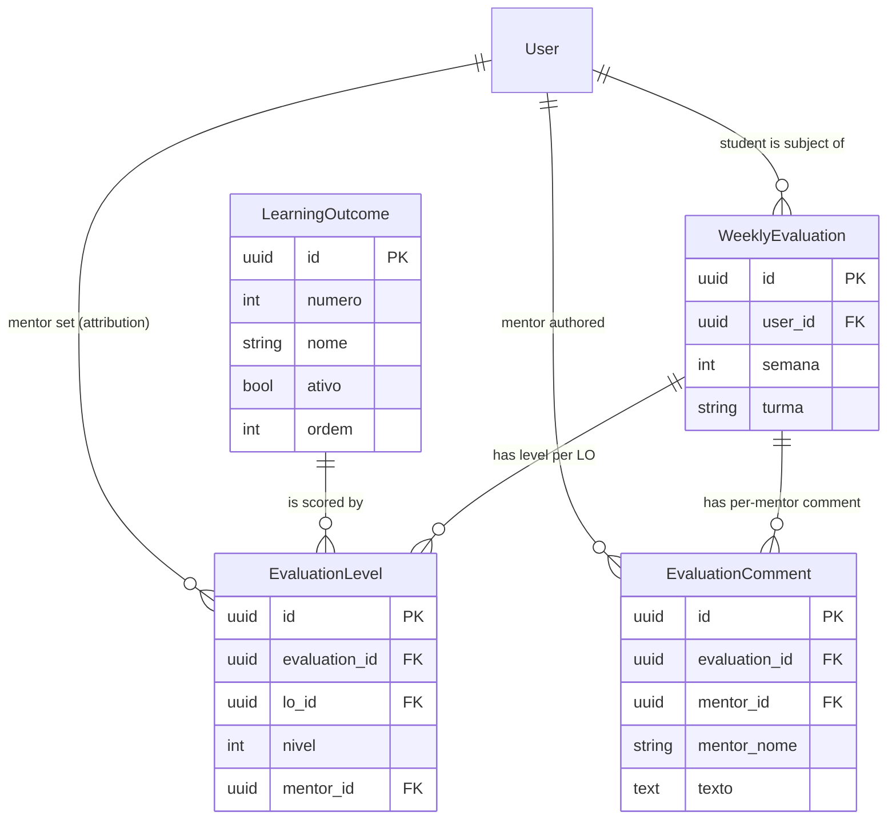

# Phase 1 Data Model: Weekly Learning-Outcome Evaluation

Four new tables are added to the existing PostgreSQL schema, following the conventions in
`backend/app/adapters/persistence/orm_models.py` (UUID PKs via `Uuid`, timezone-aware timestamps
with `server_default=func.now()`, FKs with explicit `ondelete`). Domain dataclasses mirror these in
`app/domain/models.py`. Program settings reuse the existing `config` key-value table (no new table).

## Entity: Learning Outcome

Table `learning_outcomes` — the catalog of outcomes referenced by evaluations.

| Field | Type | Constraints / Notes |
|-------|------|---------------------|
| `id` | UUID | PK, default `uuid4` |
| `numero` | Integer | NOT NULL. Display/ordering number of the LO (e.g., 1..59). |
| `nome` | String(255) | NOT NULL. Short name of the outcome. |
| `descricao` | Text | Nullable. Longer description. |
| `ativo` | Boolean | NOT NULL, default `True`. Deactivated LOs drop off new forms but remain for history. |
| `ordem` | Integer | NOT NULL, default `numero`. Explicit display order. |
| `criado_em` | DateTime(tz) | `server_default=func.now()`. |
| `atualizado_em` | DateTime(tz) | `server_default=func.now()`, `onupdate=func.now()`. |

**Indexes / constraints**: `UniqueConstraint(numero)` (`uq_lo_numero`); `Index(ativo)`.

**Validation**: `numero` ≥ 1; `nome` non-empty. Deactivation sets `ativo=False` (never deleted
while evaluations reference it).

## Entity: Weekly Evaluation

Table `lo_evaluations` — one student's assessment for one program week.

| Field | Type | Constraints / Notes |
|-------|------|---------------------|
| `id` | UUID | PK, default `uuid4` |
| `user_id` | UUID | FK → `users.id` `ON DELETE CASCADE`, NOT NULL. The student (ALUNO). |
| `semana` | Integer | NOT NULL. Program week index (≥ 1, ≤ configured num weeks). |
| `turma` | String(100) | NOT NULL. Snapshot of the student's `turma_ou_equipe` at evaluation time (for turma/week queries and reports). |
| `criado_em` | DateTime(tz) | `server_default=func.now()`. |
| `atualizado_em` | DateTime(tz) | `server_default=func.now()`, `onupdate=func.now()`. |

**Relationships**: one evaluation → many `lo_evaluation_levels` and many `lo_evaluation_comments`
(`cascade="all, delete-orphan"`).

**Indexes / constraints**:
- `UniqueConstraint(user_id, semana)` (`uq_evaluation_user_semana`) — one evaluation per student/week.
- `Index(turma, semana)` (`ix_evaluations_turma_semana`) — dashboard/report lookups.

## Entity: Evaluation Level

Table `lo_evaluation_levels` — the level (1–4) for one LO within a weekly evaluation.

| Field | Type | Constraints / Notes |
|-------|------|---------------------|
| `id` | UUID | PK, default `uuid4` |
| `evaluation_id` | UUID | FK → `lo_evaluations.id` `ON DELETE CASCADE`, NOT NULL. |
| `lo_id` | UUID | FK → `learning_outcomes.id` `ON DELETE RESTRICT`, NOT NULL. (RESTRICT preserves history; LOs are deactivated, not deleted.) |
| `nivel` | Integer | NOT NULL. Level 1–4. |
| `mentor_id` | UUID | FK → `users.id` `ON DELETE SET NULL`, nullable. Mentor who last set this level. |
| `atualizado_em` | DateTime(tz) | `server_default=func.now()`, `onupdate=func.now()`. |

**Indexes / constraints**:
- `UniqueConstraint(evaluation_id, lo_id)` (`uq_level_evaluation_lo`) — one level per LO per
  evaluation; re-save upserts (last-write-wins).
- `Index(lo_id)` for heatmap aggregation.

**Validation**: `nivel` ∈ {1,2,3,4}; `lo_id` must be an **active** LO at submit time (FR-004).

## Entity: Evaluation Comment

Table `lo_evaluation_comments` — one mentor's comment on a weekly evaluation.

| Field | Type | Constraints / Notes |
|-------|------|---------------------|
| `id` | UUID | PK, default `uuid4` |
| `evaluation_id` | UUID | FK → `lo_evaluations.id` `ON DELETE CASCADE`, NOT NULL. |
| `mentor_id` | UUID | FK → `users.id` `ON DELETE SET NULL`, nullable. Comment author. |
| `mentor_nome` | String(255) | NOT NULL. Snapshot of the author's display name (survives user changes/deletion). |
| `texto` | Text | NOT NULL. |
| `atualizado_em` | DateTime(tz) | `server_default=func.now()`, `onupdate=func.now()`. |

**Indexes / constraints**: `UniqueConstraint(evaluation_id, mentor_id)` (`uq_comment_evaluation_mentor`)
— one comment per mentor per evaluation; a mentor's re-save replaces only their own comment.

## Program settings (reuse existing `config` table)

| Key | Value | Notes |
|-----|-------|-------|
| `lo_eval_data_inicio` | ISO date | Start date defining week 1. |
| `lo_eval_num_semanas` | integer (default 12) | Number of program weeks. |

`semana_de(data, inicio) = floor((data - inicio).days / 7) + 1` (pure domain function).

## Relationship diagram

## Derived views (no new tables)

- **Pre-fill**: per LO, the `nivel` from the highest `semana < W` evaluation for the student that
  has a level for that LO (R3).
- **Dashboard**: assessed = students with a `WeeklyEvaluation` for `(turma, week)`; pending = the
  turma's other ALUNOs; byMentor = distinct students per `mentor_id` over the week's levels/comments;
  heatmap = per active LO, counts of levels 1–4 for the week; regressions = assessed student+LO whose
  `nivel` is strictly below their most recent comparable prior-week level (R4).
- **Report**: one row per turma student for the week — level per active LO (blank if unset) + the
  week's comments; students with no `WeeklyEvaluation` marked **pending** (R5).
